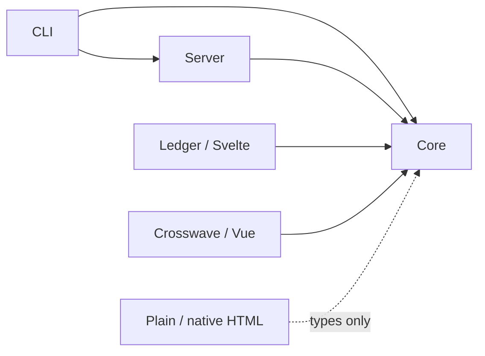

# Dirwell package transition

The repository contains an **unreleased** `@dirwell/*` alpha line, starting at exactly `0.0.1-alpha`. The published `@vp-tw/dirwell` compatibility line remains separate. The eight new packages are currently private while their runtime/platform qualification and publication setup are completed.

| Package                    | Responsibility                                                                         | Runtime dependencies              |
| -------------------------- | -------------------------------------------------------------------------------------- | --------------------------------- |
| `@dirwell/core`            | Filesystem facts, public listing contracts, static publication, browser listing loader | picomatch                         |
| `@dirwell/theme-plain`     | Minimal native HTML and pagination                                                     | None                              |
| `@dirwell/theme-ledger`    | Svelte server/client explorer                                                          | Core, Svelte                      |
| `@dirwell/theme-crosswave` | Vue explorer, Node MIME categories and VueUse gamepad                                  | Core, Vue, VueUse, MIME           |
| `@dirwell/server`          | Live HTML/JSON/files, authorization, HTTP caching, shared SSE and host adapters        | Core                              |
| `@dirwell/share-image`     | Optional build metadata, PNG renderer and bundled fonts                                | Core, resvg-js, fontkit           |
| `@dirwell/integrations`    | Explicit-theme build adapters with existing host lifecycles                            | Core, unplugin, Chokidar          |
| `@dirwell/cli`             | Explicit-theme build/server commands and executable project config                     | Core, server, import-meta-resolve |

Core and CLI never select a default theme. Plain has no JavaScript, image, font, icon, social metadata or archive-search asset by default. Frontend frameworks, image rendering, config loading and watchers are absent from core's dependency graph.

## Build and server modes

Static builds retain SSG/MPA and relative/base/html-base URL strategies. A listing policy independently selects complete/paged HTML and complete/blocked public data. Fixed plans or synchronous per-directory callbacks can use directory path, count, UTF-8 data bytes, execution operation and pagination capability. Layout mode and execution operation are distinct: live server uses directory-oriented SSG layout with `operation: 'server'`.

Server mode renders through the same theme without replacing an output tree. Its safe default previews raster/audio/video and downloads other files. Integrated file transport is opt-in; hosts can delegate file links. Express, Fastify, Hono and native Node integration paths have executed tests; other hosts with Request/Response support remain candidates, not qualified adapters.

Server responses default to no-store and ETags. Custom header and authorization hooks are asynchronous and run before conditional responses. Requested paths and canonical targets are both authorized. Optional SSE shares polling per directory, rechecks subscribers, coalesces slow consumers and releases the last subscription's timer. Rich clients load complete coherent data before enabling directory-wide filtering/sorting; live refreshes commit complete data while preserving search state.

`dirwell server` handles file-data updates independently of Farm or a build plugin. Editing theme source still needs its compiler and a server restart; this is not framework HMR. The new CLI does not silently translate legacy dev/daemon commands.

## Migration and customization

1. Choose the new core/CLI and install a theme explicitly after the alpha packages are published, using their `alpha` dist-tag.
2. Replace legacy optional-theme generation with `generateExplorer({ ...options, theme })`.
3. Configure a listing policy deliberately. For example, publish 100 HTML rows and 200 data records per block for large directories; keep complete HTML when that suits the theme and archive.
4. Use build for static output, or server for live HTML/file transport. Enable `--live` only when automatic Svelte/Vue updates are desired.

The framework themes use native Svelte/Vue templates, state and lifecycle, not serialized UI trees or the legacy DOM controllers. Their alpha option surfaces intentionally differ from the old component/project overrides; no compatibility migration for those overrides is claimed. Third-party themes can implement `ExplorerTheme.render` and own their server/client build, using the framework-neutral public facts and core browser loader.

Metadata remains an injected core provider. No image renderer is bundled in the new themes. The existing compatibility line retains its metadata/image implementation; the optional `@dirwell/share-image` provider and `@dirwell/integrations` adapters now isolate those dependencies. Source-component customization and theme HMR remain subsequent work. See [workspace releases](WORKSPACE_RELEASING.md) for offline preparation and the separate first-publication gate.

## Qualification boundary

Local installed-tarball checks exercised all three themes in both static modes, CLI build, live HTML/listing, file transfer and Node 22.19/26. Native browser tests cover 1,200 files, complete search, sorting-related keyboard selection, dialogs, archive fuzzy search, History, no-script pagination, simulated gamepad behavior and live updates with a browser cache policy.

The platform workflow additionally installs these eight tarballs on the repository's Linux/Windows/macOS × ARM64/x64 × Node 22.12/24.1/26 matrix. Its current-head result must be read before claiming those new-package environments as verified. Physical gamepads, hostile filesystem mutation, distributed caching, retained historical snapshots and production-scale performance are unverified. Earlier seven-framework UI-tree measurements remain study evidence and are not an optimized native-framework ranking.
