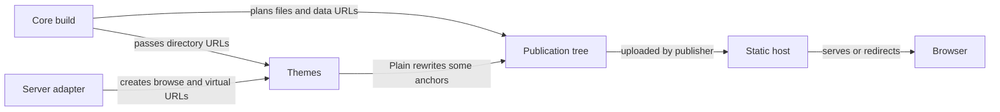
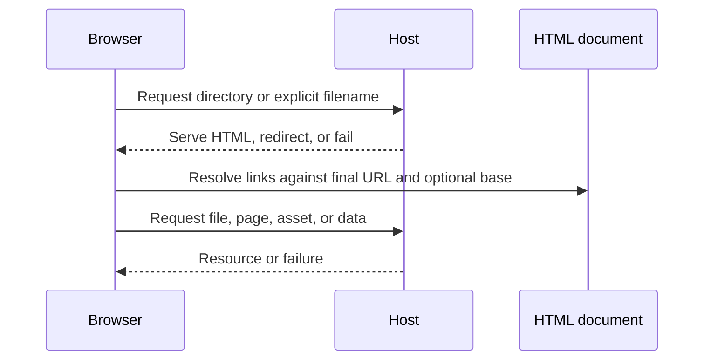
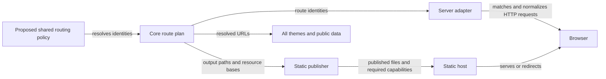

# Directory URL and publication design

Status: **Implemented in SDK 0.0.3**. The [SDK release](https://github.com/vp-tw/dirwell/releases/tag/%40dirwell/workspace%400.0.3) records the published family; this document retains the earlier local qualification and design decisions. The shared explicit-filename default has owner approval. Updated 2026-10-15. Decision owner: repository owner. Breaking changes, implementation and evidence-driven spec revisions are authorized. Actual hosting configuration remains a deployment-owner qualification.

Dirwell should own directory routing in Core, share the policy with the live server, and give themes resolved URLs. A theme must not append `index.html`, remove a slash, infer a data URL from a page URL, or choose a deployment policy. Static publication and HTTP redirects remain different responsibilities.

This document inventories the finite configuration dimensions, their combinations, exceptions, validation gates, and documentation locations. It does not promise compatibility with every possible hosting rule. Unsupported combinations must fail clearly or be documented as requiring a host capability, rather than silently producing broken links.

## Implementation decisions and verification

The owner authorized implementation, verification and evidence-driven spec revisions on 2026-10-15, with breaking changes permitted. The shared explicit-filename default remains confirmed. The subsequent owner request, "auto dev to release if no risk", authorizes in-scope branch, commit, PR, merge and release work under the repository release gates. The local qualification below predates that delivery phase; final registry and deployed-site proof must be recorded separately.

The working tree now implements `routing.directoryUrls` in Core and accepts the same policy in server and build adapters. CLI config places it at the top level; `--directory-urls` overrides it. Plain no longer accepts `portableLinks`, and all official renderers consume supplied links without appending filenames. `assetHrefForDirectory` and `directoryPathForEntry` replace URL-shape inference for rich data snapshots. Missing directory targets return null and render without links.

Resolved details from implementation:

- Clean builds use `folder.html`, while original downloads stay below `folder/`. Later clean pages use sibling HTML files with distinct extensionless public URLs. Static root still resolves under the slash-terminated deployment base; live clean root is `/browse` under its mount.
- Default owned-homepage coexistence keeps an explicit `_dirwell.html` fallback and explicit co-located pagination in all styles. Caller-supplied non-index output names require explicit routing; silent per-page coercion is not supported.
- A clean link to the containing directory may require `../folder`, rather than `.`: the latter resolves to a slash URL. Core computes references from the public document base and tests the actual resolved targets.
- Live GET/HEAD aliases receive 307 after logical/target authorization and retain queries. In clean mode, terminal `index.html` is a literal directory name, not an ancestor alias; this removes an otherwise ambiguous route. Other methods retain 405.
- Rich themes record the activated entry before saving navigation state; History focus restoration does not depend on a mouse click producing a browser focus event.
- Page/source collisions fail before output replacement, including caller-forced source-homepage replacement and clean same-stem downloads. Skipped homepage-less ancestors do not become invented links. The current dry-run report describes each directory's entry output/public path; it does not simulate renderer assets or enumerate every later pagination file.
- Crosswave's existing unconditional cross-document View Transition could suppress hit testing with JavaScript disabled in Chromium. A two-page fail/pass/fail reproduction verified the mechanism; opt-in is now inside `@media (scripting: enabled)`, preserving native no-script navigation without force-clicking tests. See [reproduction](native-transition-repro.mjs), [CSS View Transitions hit testing](https://www.w3.org/TR/css-view-transitions-1/), and [scripting media feature](https://developer.mozilla.org/en-US/docs/Web/CSS/Reference/At-rules/%40media/scripting).

Qualification results are retained in [verification.json](verification.json):

| Check                                | Result                                                                                                                                                                                       |
| ------------------------------------ | -------------------------------------------------------------------------------------------------------------------------------------------------------------------------------------------- |
| Unit and integration regression      | 233 passed, including the complete 864-combination publication matrix, collision/rollback, CLI and live-route assertions                                                                     |
| Full browser regression              | 594 passed across Chromium, Firefox and WebKit; 55 routing scenarios per engine are included                                                                                                 |
| Additional local-file boundary proof | The existing file-URL scenario was strengthened after the full run and passed again in all three engines: default/custom filenames, pagination, nested navigation, skipped ancestor and Home |
| Installed SDK family                 | All nine local tarballs installed without lifecycle scripts; existing consumer plus 54 routing builds, three live policies and CLI override passed on each of Node 22.19.0 and 26.12.0       |
| Static and package checks            | Dependency policy audit, formatting, lint, template formatting, TypeScript, production build and historical facade's installed-tarball consumer passed                                       |
| Documentation                        | Root and `/dirwell/` site builds passed; each link scan checked 670 internal links/anchors across 18 documentation/home pages                                                                |

The bounded compatibility suite is recorded separately in the evidence file. Native no-script Crosswave navigation also has a retained [fail/pass/fail reproduction](native-transition-repro.mjs). These results qualify the fixture's exact-file, directory-index and file-first-clean host behavior, not a vendor deployment. No comparative performance SLA, other OS/architecture qualification, physical controller/mobile-device validation, publication or deployment is claimed.

Reproduce current checks with `pnpm audit:dependencies`, `pnpm check`, `pnpm test`, `pnpm build`, `pnpm verify:package`, `pnpm test:browser:all`, `pnpm test:compat`, `pnpm site:build`, and `SITE_BASE=/dirwell/ pnpm site:build`. The focused source tests are [routing.test.mjs](../../../test/routing.test.mjs) and [routing.spec.mjs](../../../test/browser/routing.spec.mjs). For installed routing proof, build and pack all nine packages with `node scripts/pack-workspace.mjs <artifact-directory>`, run `node scripts/verify-workspace-consumer.mjs <artifact-directory>`, copy [installed-probe.mjs](installed-probe.mjs) into that disposable installed project, and run it with the desired Node binary. This uses local working-tree artifacts, not the published 0.0.2 API.

Sections 1–8 retain the original research, planned acceptance and pre-change baseline for traceability; the implementation decisions and qualification above supersede their proposed or unresolved wording. The old `probe.mjs` and `live-probe.mjs` require their recorded pre-change source snapshots because `portableLinks` was removed; current reproducible qualification is `test/routing.test.mjs` and `test/browser/routing.spec.mjs`. Historical counts are not current-source proof.

## 1. Problem, scope, and evidence

- **Affected users:** publishers moving the same archive among static websites, object storage, local files, embedded applications, and the live server.
- **Observed problem:** Plain rewrites some directory URLs after Core has generated its public data. Other official themes use Core URLs. The apparent theme preference actually affects publication, navigation, metadata, and host behavior.
- **Desired outcome:** one policy determines consistent page links and output paths; users can select a policy that their host can serve and follow explicit guidance before changing it.
- **Current coverage:** explicit filenames and directory URLs are partially available; extensionless directory pages have no first-class policy. Existing `urlStrategy` controls link bases, not slash policy.
- **Scope:** Core routing implementation, regression verification and corresponding documentation. Delivery through release is authorized by the subsequent auto-development request. Vivace changes remain outside this repository task; notify its existing Claude Code session about the new contract.
- **Non-goals:** changing original download filenames, file authorization, selection rules, rich-theme DOM/data-loading strategies, or automatically changing remote host configuration.

### Evidence ledger

| Claim                                                                                                                                                        | Status                                         | Evidence                                                                                              | Limit                                                                                                            |
| ------------------------------------------------------------------------------------------------------------------------------------------------------------ | ---------------------------------------------- | ----------------------------------------------------------------------------------------------------- | ---------------------------------------------------------------------------------------------------------------- |
| Core maps generated `index.html` pages to directory URLs, but preserves custom page filenames                                                                | Verified source and local generation           | [generator](../../../packages/core/src/generator.ts), `pagePathForDirectory` and `hrefForLogicalPath` | No remote host tested                                                                                            |
| Plain defaults `portableLinks` to true and rewrites HTML directory anchors                                                                                   | Verified source and local generation           | [Plain](../../../packages/theme-plain/src/index.ts)                                                   | Its public records still originate from Core                                                                     |
| Theme page data derives directory identities partly from URL shapes                                                                                          | Verified source                                | [shared page model](../../../packages/shared-theme/src/page.ts), `folderDataHref`                     | A clean-URL design must replace this inference                                                                   |
| Live HTML uses `/browse/`, recognizes `index.html` aliases, and paginates with queries                                                                       | Verified source and 16 direct-handler requests | [live HTML](../../../packages/server/src/html.ts)                                                     | No socket, proxy, or authorization deployment proof                                                              |
| 288 static combinations generated; 144 mirrored cases preserved the fixture's owned homepage                                                                 | Verified generation probe                      | [baseline](baseline-summary.json), [probe](probe.mjs)                                                 | Core/Plain source; rich themes use existing dist bundles whose freshness was not qualified; no browser execution |
| Explicit `outputName: "index.html"` replaces the mirrored homepage in generated output; skipping a homepage-less ancestor still emits links to that ancestor | Verified four edge fixtures                    | [edge observations](edge-baseline.json), [edge probe](edge-probe.mjs)                                 | Original source directory is unchanged; the loss is in the generated copy                                        |
| Hosts can redirect explicit filenames and disagree on directory lookup                                                                                       | Verified upstream documentation                | Sources in section 10                                                                                 | Documentation is not deployed integration evidence                                                               |

### Terms

| Term              | Meaning                                                                                              |
| ----------------- | ---------------------------------------------------------------------------------------------------- |
| Logical directory | Filesystem-relative identity such as `packages/core`; not a URL                                      |
| Output path       | File written into the publication tree, such as `packages/core/index.html`                           |
| Public page URL   | URL readers request, such as `/downloads/packages/core/`                                             |
| Link base         | URL against which relative references resolve, including an HTML `<base>` when present               |
| Canonical URL     | Preferred public URL recorded in metadata and the route plan; does not itself cause an HTTP redirect |
| Alias             | Alternate request path that the host may redirect or serve                                           |
| File URL          | Original downloadable file's URL; independent from directory page routing                            |
| Host capability   | A serving/rewrite/redirect behavior verified for a particular configuration                          |

### Current relationships



Question: who currently decides a URL? Evidence: generator, Plain, and server source above. Takeaway: decisions are split. Implication: changing one theme cannot establish a shared routing contract. Unknown: behavior of each actual deployed host configuration.



Question: why can a page load but navigation fail? Evidence: standard URL resolution and the host documentation below. Takeaway: the final document URL affects later requests. Implication: a successful root response is insufficient proof. Unknown: actual redirect chains and client behavior until browser tests run.

## 2. Where the setting belongs

### Responsibility map

| Layer                   | Owns                                                                                                   | Must not own                                                              |
| ----------------------- | ------------------------------------------------------------------------------------------------------ | ------------------------------------------------------------------------- |
| Core routing model      | Logical directory/page identity; resolved public URLs; canonical page URL; shared routing option types | Vendor host redirects or theme styling                                    |
| Core static publisher   | Output placement, complete route plan, collision checks, resource-relative references                  | Mutating a deployed CDN                                                   |
| Server adapter          | Incoming route matching, aliases, redirects, mount prefix, request method handling                     | Static output layout settings                                             |
| Theme                   | Rendering the supplied links, breadcrumbs, pagination, and metadata                                    | `portableLinks`, slash selection, filename appending, URL-shape inference |
| CLI/config/integrations | Parse, validate, and forward the same Core policy                                                      | Separate implementations of URL rules                                     |
| Deployment platform     | Serve files, rewrite requests, normalize aliases, set cache rules                                      | Silently overriding the documented public URL contract                    |

**Recommendation:** a shared `routing` object, owned by Core. In CLI configuration it belongs alongside `theme`, `build`, `server`, and `listing`; build and server both receive it. Static link-base strategy remains in `build`; server mount remains in `server`. Do not put static `base` or `urlStrategy` into the shared routing policy: server endpoint URLs have a different contract.

Next-release API implemented in this checkout, **not available in published 0.0.2**:

```js
// dirwell.config.mjs — next release
export default {
  routing: { directoryUrls: "explicit" },
  theme: createPlainTheme(),
  build: { urlStrategy: "relative", base: "/downloads/" },
  server: { mountPath: "/downloads" },
};
```

```js
// Core API — next release
await generateExplorer({
  sourceDir,
  outputDir,
  theme,
  routing: { directoryUrls: "slash" },
  urlStrategy: "base",
  base: "/downloads/",
});
// Server API receives the same routing policy, plus its existing mountPath.
```

There is one shared CLI routing policy, with no additional per-theme or per-mode override layer in the initial design. Separate build/server choices can use separate config files or API calls. A future override feature needs an explicit precedence table rather than implicit merging.

### Proposed profiles

| `directoryUrls` | Public child URL               | Static output       | Requirement                                                                             |
| --------------- | ------------------------------ | ------------------- | --------------------------------------------------------------------------------------- |
| `explicit`      | `/downloads/folder/index.html` | `folder/index.html` | Exact file access; host redirects must still be considered                              |
| `slash`         | `/downloads/folder/`           | `folder/index.html` | Directory-index serving                                                                 |
| `clean`         | `/downloads/folder`            | `folder.html`       | Extensionless mapping, correct file-versus-directory precedence, and rebased references |

These are proposed bundles of URL and layout behavior, not three string transforms. Do not expose an independent output-layout switch initially: the off-diagonal combinations remain research/test inputs, not automatically supported API values. `ssg`/`mpa` remain asset/data layout modes and must not be renamed or overloaded to mean HTML filename layout.

**Owner-confirmed default (2026-10-15): `explicit` across every theme.** It requires the fewest host lookup features and supports native Plain file navigation. This changes rich-theme public links and Core public records. It does not promise that a host will retain the explicit URL after redirects. Choose `slash` explicitly on qualified directory-index hosts. Gate `clean` behind its collision and browser proof before exposing it as supported.

### Options compared

| Option                                                   | Coverage                                    | Cost and tradeoff                                                                                   | Recommendation                                   |
| -------------------------------------------------------- | ------------------------------------------- | --------------------------------------------------------------------------------------------------- | ------------------------------------------------ |
| Keep the Plain option; improve docs                      | Helps current Plain users only              | HTML/data/theme divergence remains                                                                  | No                                               |
| Move a boolean to Core                                   | Consistent explicit versus slash links      | Cannot describe extensionless output or page identities                                             | Smaller alternative if only two modes are wanted |
| Core routing profiles plus operation-specific planners   | Covers static/live and consistent consumers | Breaking contract and qualification work                                                            | Recommended                                      |
| Automatic vendor detection or arbitrary routing callback | Potentially broad host adaptation           | Build environment cannot reliably predict deployed rewrites; arbitrary outputs undermine validation | Defer                                            |

Selection criteria: no source-data loss, native links with JavaScript disabled, consistent Core/theme/data URLs, predictable defaults, explicit unsupported combinations, and reproducible host qualification. Implementation effort and production latency are unknown; derive them from the proof, not local generation timings.

### Target relationships



Question: where should routing live? Evidence: current split and the Docusaurus/Astro comparisons below; this entire graph is a proposal. Takeaway: identity and URL planning have one owner; HTTP serving remains separate. Implication: themes can change without changing deployment URLs. Unknown: final API names, default approval, and clean-profile qualification.

## 3. Exhaustive core combination matrix

The core model enumerates **3 URL forms × 2 output layouts × 3 link strategies × 8 serving profiles = 144 cases**. [machine-readable results](scenario-matrix.json) retain every combination and its expected outcome. These are design-model results, **not 144 host tests**.

The modeled child is `folder`, under a known deployment root, with no source collision. `directory` layout writes `folder/index.html`; `flat` layout writes `folder.html`. Root output always remains an index document; root/child differences are covered separately below.

### Serving profiles and result vocabulary

| Profile           | Exact contract used by the model                                                                            |
| ----------------- | ----------------------------------------------------------------------------------------------------------- |
| `exact`           | Serves exact object keys; no index lookup or clean rewrite                                                  |
| `directory-index` | Exact files plus `/folder/` to `folder/index.html`; bare directory canonicalizes to a slash                 |
| `clean-files`     | Exact files plus `/folder` to `folder.html`, with file mapping taking precedence over a same-stem directory |
| `clean-index`     | Exact files plus `/folder` to `folder/index.html`, without changing the requested URL                       |
| `force-slash`     | Maps the chosen layout but normalizes all modeled page aliases to `/folder/`                                |
| `force-clean`     | Maps the chosen layout but normalizes all modeled page aliases to `/folder`                                 |
| `file`            | Native local file access; explicit files only for this navigation contract; no HTTP rewrite                 |
| `spa-fallback`    | Exact files work; non-file requests return a generic application shell, not a qualified directory page      |

`works` means the synthetic host contract can serve the intended document without changing its URL. `redirect-mismatch` means it resolves but disagrees with the selected public URL policy; references need validation at the final URL and canonical metadata must agree. `unresolved` means no modeled lookup finds that document. `wrong-document` means a shell response can hide the failure. `unsupported-file-base` means rooted HTTP deployment bases cannot locate a local archive. These statuses make no claim about a vendor's untested status codes.

| URL form / layout    | Exact      | Directory index   | Clean files | Clean index | Force slash       | Force clean       | Local file | SPA fallback   |
| -------------------- | ---------- | ----------------- | ----------- | ----------- | ----------------- | ----------------- | ---------- | -------------- |
| Explicit / directory | works      | works             | works       | works       | redirect-mismatch | redirect-mismatch | works*     | works          |
| Explicit / flat      | works      | works             | works       | works       | redirect-mismatch | redirect-mismatch | works*     | works          |
| Slash / directory    | unresolved | works             | unresolved  | unresolved  | works             | redirect-mismatch | unresolved | wrong-document |
| Slash / flat         | unresolved | unresolved        | unresolved  | unresolved  | works             | redirect-mismatch | unresolved | wrong-document |
| Clean / directory    | unresolved | redirect-mismatch | unresolved  | works       | redirect-mismatch | works             | unresolved | wrong-document |
| Clean / flat         | unresolved | unresolved        | works       | unresolved  | redirect-mismatch | works             | unresolved | wrong-document |

`*` Local-file success requires `relative` links and native HTML behavior. Rich themes' fetch/client execution remains unqualified on `file://`. Only the three diagonal profiles in section 2 are proposed public modes; other rows show why independent layout and slash switches create invalid combinations.

### Link strategy cross-product

| Strategy    | Explicit and slash profiles                                     | Clean profile                                                                 | Root/subpath and external origin                                                                                           |
| ----------- | --------------------------------------------------------------- | ----------------------------------------------------------------------------- | -------------------------------------------------------------------------------------------------------------------------- |
| `relative`  | Resolve from each actual document location                      | Generate references from `/folder`, not an assumed `/folder/`                 | Movable archive when host policy matches; exact files support native Plain browsing                                        |
| `base`      | Root all generated navigation/resource URLs under declared base | Rooted references avoid local document-depth ambiguity                        | Base must match deployed prefix; an absolute origin adds CORS/CSP/cookie considerations for fetches                        |
| `html-base` | Emit `<base>` and resolve generated refs against it             | Base must use the planned directory/resource base, not an inferred URL suffix | Also affects custom relative links, fragments, forms, favicon and downloads; HTTP root base is not portable to local files |

A reference must be resolved exactly once. JSON records resolve against their documented `hrefBase`, not whichever HTML page happened to request them. An HTML `<base>` does not change JSON's own URL-resolution contract.

### Relative reference example

For a real source file `folder/note.txt`, requested public URLs under `/downloads/` require:

| Page URL                       | `note.txt` resolves to       | Correct relative link to the real file |
| ------------------------------ | ---------------------------- | -------------------------------------- |
| `/downloads/folder/index.html` | `/downloads/folder/note.txt` | `note.txt`                             |
| `/downloads/folder/`           | `/downloads/folder/note.txt` | `note.txt`                             |
| `/downloads/folder`            | `/downloads/note.txt`        | `folder/note.txt`                      |
| `/downloads/folder.html`       | `/downloads/note.txt`        | `folder/note.txt`                      |

This is why a clean route cannot be produced by trimming a slash. Parent/Home, nested children, assets, manifests, metadata images, and page snapshots require the same planning discipline.

## 4. Additional dimensions and required outcomes

These tables partition the remaining supported state space. Combine their rules with the 144-case matrix; a rejection or unavailable target dominates a successful serving result. They are acceptance requirements for future work, not claims that all combinations have been run.

### Execution, interfaces, and themes

| Case                                                  | Required result                                                                                |
| ----------------------------------------------------- | ---------------------------------------------------------------------------------------------- |
| Static `ssg` versus `mpa`                             | Same selected public directory policy; mode may relocate shared assets/data only               |
| Plain, Ledger, Crosswave                              | Same Core entry href, breadcrumb, parent, page-1 and canonical identities                      |
| Third-party theme                                     | Only consume resolved context; document migration of string-appending renderers                |
| JavaScript disabled                                   | Every published page, child, parent, breadcrumb, and pagination link remains usable            |
| Rich client enabled                                   | Fetch correct page/data URLs, update History with public URL, retain navigation/focus behavior |
| Browser Back/Forward, reload, direct deep link        | Same directory, page number and identity as native navigation; no client-only routing success  |
| Live server                                           | No static file-layout option; canonical style implemented by server routing, not theme output  |
| CLI/API/build integration                             | Identical normalized policy and errors; adapter preserves host app's non-owned routes          |
| CLI config and flags conflict                         | Explicit CLI routing flag wins; API adapter does not discover cwd config implicitly            |
| Invalid enum, null, unknown keys, old `portableLinks` | Error names correct replacement and path; no silent fallback                                   |
| No policy supplied                                    | One documented default chosen before rendering; no theme-dependent branch                      |

### Directory identity, root, and output naming

| Case                                                          | Required result                                                                                                                                                               |
| ------------------------------------------------------------- | ----------------------------------------------------------------------------------------------------------------------------------------------------------------------------- |
| Explorer root `/`                                             | Remains `/` for slash/clean, `/index.html` for explicit; never empty URL or `.html`                                                                                           |
| Mounted root `/downloads/`                                    | Clean may use `/downloads` only if host route is owned and not confused with a file; explicit uses `/downloads/index.html`; base remains `/downloads/` for resource placement |
| Nested directory and empty directory                          | Reachable planned page; empty listing does not disappear                                                                                                                      |
| Default source `index.html` or `index.htm`                    | Preserve source bytes; explorer fallback is a distinct explicit target, not the source homepage                                                                               |
| Source `_dirwell.html` also exists                            | Preserve it; skip or reject according to a documented policy; do not invent overwrite permission                                                                              |
| Caller returns `outputName: null`                             | No explorer page; do not invent `index.html` or a rich-data link to it                                                                                                        |
| Skipped directory with an owned homepage                      | Link to the owned site as an exit; retain its host-native directory semantics                                                                                                 |
| Skipped directory without a homepage, descendants generated   | Descendants remain independently planned; missing ancestor is not a valid generated breadcrumb target; define omit/unavailable behavior                                       |
| Custom `files.html`                                           | Exact filename is authoritative; reject incompatible global clean/slash requests or expose an explicit per-page escape with diagnostics; never silently remove its extension  |
| Explicit output collides with a source file or directory      | Fail planning before output replacement; do not assume a caller-supplied name authorizes loss                                                                                 |
| Flat clean output `folder.html` collides with a real download | Fail before replacement; no auto-renaming source or changing its download URL                                                                                                 |
| Mirrored `folder/` and generated `folder.html` coexist        | Require qualified route precedence; many hosts prioritize directory lookup differently                                                                                        |
| Case variants, Unicode normalization, platform-reserved names | Check collisions on supported filesystems and host rules; fail nonportable plans rather than overwrite                                                                        |
| Generated pagination/assets conflict with source              | Fail before publishing; deterministic collision diagnostics include both identities                                                                                           |

The current default resolver is conservative, but an explicit `outputName` has a different overwrite risk. The new planner must make collision handling uniform; this is a required future invariant, not a verified current guarantee for arbitrary custom names.

### Files, links, selection, and external resources

| Case                                                                  | Required result                                                                                                                                                 |
| --------------------------------------------------------------------- | --------------------------------------------------------------------------------------------------------------------------------------------------------------- |
| `mirror: true`                                                        | Source files retain their logical paths and bytes; URL profile changes only explorer pages                                                                      |
| `mirror: false`, same host overlay                                    | Require known file layout; publish all owned assets/data required by the theme; do not blindly copy generated private control files into a public download list |
| `mirror: false`, separate file host                                   | `fileHref` controls files only; directory, asset and data URLs remain Core-owned                                                                                |
| `fileHref` returns null                                               | Render no file link; no fallback to an invented local URL                                                                                                       |
| Signed file URL, query or fragment                                    | Preserve exactly; no `.html` appending, slash trimming, canonicalization or query reordering                                                                    |
| Space, `#`, `?`, `%`, `+`, non-ASCII segment                          | Encode path segments once; preserve literal filenames; no decode/re-encode of entire URLs                                                                       |
| Dot/dot-dot, encoded separators, backslash, absolute filesystem paths | Existing validation and authorization boundaries remain; routing must not create a traversal alias                                                              |
| Internal directory symlink                                            | Use the existing permitted target identity and its planned route; test followed/unfollowed aliases                                                              |
| Outside, broken, cycle or excluded symlink                            | Preserve unavailable/exit behavior; new route forms must not expose a target previously denied                                                                  |
| Included/excluded directory or ignore-file rule                       | Routing does not reopen excluded paths; missing links are omitted or deliberately unavailable                                                                   |
| Host lowercases, decodes twice, or normalizes Unicode                 | Outside generic guarantee; qualify or reject affected archive, do not silently rewrite source names                                                             |

### Pagination, data, metadata, and client state

| Case                                                       | Required result                                                                                                 |
| ---------------------------------------------------------- | --------------------------------------------------------------------------------------------------------------- |
| All HTML / paged HTML × all data / blocked data            | Four independent combinations; route selection does not imply a data-loading strategy                           |
| First, middle, last, empty page                            | Deterministic distinct output/URLs; native Previous/Next and page-1 links agree                                 |
| Static pagination                                          | Write actual page files; do not substitute `?page=2` without an actual serving layer                            |
| Live pagination                                            | Use request queries and preserve them through aliases/redirects; invalid page is a real error                   |
| Listing block/manifest hrefs                               | Stable public identities, correct `hrefBase`, complete records and revision agreement                           |
| Rich page snapshots                                        | Explicit data identity supplied by Core; do not infer directory from a clean page's parent pathname             |
| Canonical and `og:url`                                     | Equal planned public page URL, including page number and deployment prefix; metadata remains opt-in             |
| Metadata provider callbacks                                | Receive output path separately from public page URL; callback timing and async awaiting documented              |
| Search result, archive dialog, keyboard/gamepad navigation | Same route as anchor; data and History requests use planned identities                                          |
| Live refresh/SSE                                           | Endpoints remain under mount; slash policy applies to HTML directory routes only                                |
| Fragment-only/custom relative links under `<base>`         | Browser test actual destination; document broader `<base>` effects                                              |
| Partial upload or stale cached HTML/JSON                   | Detect missing/incoherent resources; release whole tree coherently; never call a root 200 complete verification |

### Requests, hosting, and rollout

| Case                                                                     | Required result                                                                                                            |
| ------------------------------------------------------------------------ | -------------------------------------------------------------------------------------------------------------------------- |
| GET and HEAD canonical route                                             | Same resource/status/headers; HEAD has no body                                                                             |
| GET/HEAD alias                                                           | Proposed server default is 307 to the selected canonical route, preserving query; exact redirect status remains reviewable |
| POST/PUT/DELETE on directory route                                       | Existing 405 behavior; do not redirect a mutating method into another route                                                |
| Unauthorized alias/canonical path                                        | Authorization before revealing target-specific aliases; no bypass via extension or slash variant                           |
| Root mount versus nested mount, proxy prefix                             | Correct public mount; no leaked loopback host or invented forwarded prefix                                                 |
| `/browse` versus `/browse/`                                              | New server router explicitly normalizes this pair; current `/browse` is 404 in the probe                                   |
| Existing app route/file shares clean path                                | Reject reservation/registration conflict; never steal a host app route                                                     |
| Host adds slash, removes slash, strips `.html`, or rewrites `index.html` | Public plan and canonical metadata must match final route, or select another profile; detect loops                         |
| SPA fallback returns 200                                                 | Assert directory identity/content and resource URLs, not status alone                                                      |
| Custom domain versus preview, root versus project subpath                | Qualify each routing configuration; a vendor name is insufficient                                                          |
| Old/new deploy coexist, rollback                                         | Restore code, whole output and host configuration together; avoid permanent redirects before qualification                 |
| Old links/bookmarks                                                      | Provide alias/redirect plan where host permits it; source-download URLs remain unchanged                                   |
| CDN cache keys/redirect cache                                            | Measure alias hops and stale behavior; no generic zero-cost claim                                                          |

## 5. Planning algorithm and invariants

Proposed order:

1. Validate policy and operation-specific settings. Resolve selection and authorized logical identities without changing existing boundaries.
2. Await each output/selection callback once per directory. Determine generated, skipped, owned-site, and unavailable targets.
3. Build the complete output and route plan: logical directory/page number, actual output path, canonical public URL, aliases, resource base, data identities and required host capabilities.
4. Detect output collisions, public-route collisions, reserved names, and incompatible custom output names before replacement. For streaming/live reads, route validation happens before returning HTML and file access retains its own authorization checks.
5. Generate references separately for HTML, JSON `hrefBase`, metadata, and client History. Themes receive resolved values; remove `folderDataHref` pathname guessing and Plain suffix rewriting.
6. Render and publish with existing ownership/staging protections. Report entry URL and required serving behavior in dry-run/build reports.
7. On live requests, parse/validate/authorize logical identity, handle method, normalize owned aliases, and render canonical route; keep file/data/SSE namespaces independent.

Invariants: a route never changes source bytes; every generated native link identifies the same target as Core records; no alias bypasses authorization; a failed plan leaves previous output intact; metadata/client URLs match the public plan; unsupported host semantics are disclosed rather than guessed.

No production performance baseline has been established. The plan is per selected directory/page, not per theme DOM row. Qualification must report output count/bytes, build time, redirect hops, and rich-client requests against a fixed fixture; route planning must not introduce an archive scan on each link click. No performance SLA is proposed before measurement.

## 6. Validation plan and results

### Completed baseline

The retained probe enumerated `2 modes × 3 strategies × 4 theme variants × 3 output policies × 2 HTML plans × 2 mirror values = 288` generation cases on Node 26.12.0. All generated. Every one of the 144 mirrored cases retained the fixture's owned `index.html` bytes. The Plain variants use current source; Ledger/Crosswave use existing local dist artifacts, so this is not current-source qualification of their complete renderers.

Observed example: Core supplies `child/`; default Plain HTML emits `child/index.html`; Plain with `portableLinks: false`, Ledger, and Crosswave emit `child/`. Core custom output resolves `child/files.html`. Skipped owned sites remain exits. The encoded sample `note #%.txt` becomes `note%20%23%25.txt`.

The 16 live-handler requests confirmed current root redirect 307, `/browse` 404, and accepted child slash/no-slash/index aliases. These do not establish a canonical redirect policy: accepted child variants returned 200 without normalization. Plain's setting still changes anchors independently of the server's directory URL callback.

Four extra edge fixtures confirmed: `index.htm` selects `_dirwell.html`; an occupied index plus occupied fallback skips that explorer page; a caller-forced `index.html` replaces the mirrored homepage in generated output; skipping a homepage-less parent retains a link to its directory URL. The latter two are current design hazards to address in the planner, not behavior to preserve merely for compatibility. The original source fixture was never used as output.

Historical generation can be reproduced against the recorded pre-change sources with `node docs/design/url-publication/probe.mjs /tmp/dirwell-url-baseline.json`; this command is not a current-source test. Run from any cwd; artifacts are written only to the explicit destination and temporary fixtures are removed in `finally`. This probe needs already-built rich-theme dist assets and does not rebuild them. [Compact evidence](baseline-summary.json) and [live observations](live-baseline.json) are retained; the full original generation output was intentionally reduced to counts and representative records.

Reproduce the request and edge observations with `node docs/design/url-publication/live-probe.mjs` and `node docs/design/url-publication/edge-probe.mjs`; both print JSON and remove their temporary fixtures. All three probes require a Node runtime capable of direct TypeScript-source imports; the retained evidence used Node 26.12.0, not a new qualification of the package's Node 22 support.

### Acceptance inventory and deployment gates

| Gate                   | Minimum cases                                                                                                                                                                         | Pass criterion                                                                                                         | Owner / evidence                                 |
| ---------------------- | ------------------------------------------------------------------------------------------------------------------------------------------------------------------------------------- | ---------------------------------------------------------------------------------------------------------------------- | ------------------------------------------------ |
| Host capability model  | 144 modeled URL/layout/strategy/host combinations; inventory only, not executed host tests                                                                                            | Separate modeled host expectations from the three supported API profiles                                               | Implementer; machine-readable matrix             |
| Full static generation | Every public profile × 2 modes × 3 strategies × 2 bases × 3 official themes × 2 mirror values × 4 HTML/data plans = 864 cases, before unsupported file/host combinations are filtered | Native URLs/data bases/output paths resolve to intended fixture; source hashes unchanged                               | Implementer; artifact and assertion report       |
| Browser navigation     | Every supported profile × theme × JavaScript on/off × root/subpath                                                                                                                    | Direct child load, child/parent/Home, reload, History, pagination, search/data and downloads identify expected content | Implementer; browser report and network traces   |
| Local files            | Plain explicit+relative, nested/custom/paged/skipped fixtures                                                                                                                         | Navigate without HTTP or JavaScript; rich fetch mode is explicitly outside this promise                                | Implementer; browser evidence                    |
| Live server            | Every supported style × root/nested mount × GET/HEAD/other methods × canonical/aliases × page queries                                                                                 | Correct canonical response, no loops, query retained, authorization preserved                                          | Server maintainer; request/response report       |
| Collision fixtures     | Source `folder.html`, owned `index.htm`, `_dirwell.html`, skipped ancestor, Unicode/case, reserved assets and page-name collisions                                                    | Reject before replacement or preserve declared exit semantics                                                          | Implementer; source/output hashes                |
| Host qualification     | Exact-key origin, directory-index host, clean-mapping host, redirecting host, SPA fallback negative case                                                                              | Final URL/content/resource/data/canonical agreement on preview and intended mount                                      | Deployment owner; dated config and traces        |
| Packaging and docs     | Core, CLI, server, integrations, official and third-party themes                                                                                                                      | Installed consumers run examples; removed option yields actionable error                                               | Release maintainer; package/documentation checks |

The 864 count is `3 × 2 × 3 × 2 × 3 × 2 × 4`; it is now an executed assertion suite in `test/routing.test.mjs`. The 144 host combinations remain model-only; arbitrary host rules are not inputs to the Core API. Actual deployment-host qualification is a separate gate before publishing to that host. Do not substitute pairwise sampling for this finite core suite. Larger source-name and hostile-host spaces use explicit equivalence classes and boundary fixtures; no finite test can exhaust arbitrary rewrites or adversarial filesystem races.

### Decision-changing unknowns

| Question                                                                   | Cheapest reliable proof and threshold                                                                                                                               | Result branch                                                                                                     |
| -------------------------------------------------------------------------- | ------------------------------------------------------------------------------------------------------------------------------------------------------------------- | ----------------------------------------------------------------------------------------------------------------- |
| Does clean flat output work when mirrored directories share the same stem? | One nested archive with `folder/` plus `folder.html`, tested on each candidate config; canonical route and every native/download link must identify correct content | Pass: qualify that config; fail: require explicit route mapping or keep clean unsupported                         |
| Can rich clients navigate clean output without pathname inference?         | One nested directory and two data pages per rich theme; native and client navigation/History must agree                                                             | Pass: use explicit planner data identities; fail: redesign the shared page contract before implementation expands |
| Should the next default become explicit for every theme?                   | Owner selected explicit filenames in this conversation on 2026-10-15                                                                                                | Resolved: use explicit as the shared default; host normalization remains a qualification concern                  |
| What happens to custom `outputName` under slash/clean?                     | Owner chooses strict rejection or a documented per-page explicit escape; probe index collisions first                                                               | Prefer a diagnostic explicit escape only for preserved owned-page coexistence; reject ambiguous custom requests   |
| Which server alias status is appropriate?                                  | Review cache/rollback requirements and exercise GET/HEAD/query/auth                                                                                                 | Prefer temporary 307 initially; permanent redirect is a separate reviewed deployment choice                       |

No invented time estimates: the next step establishing effort is the nested clean-route proof and planner contract review. The owner/implementer should bound that proof before scheduling wider work.

## 7. Breaking migration and delivery sequence

1. Approve routing ownership, profiles, default, and custom-output behavior. Pin final API names and a versioned theme-context contract.
2. Prove clean routes and collision rules with the small fixtures above; if a host cannot support them, document the limitation instead of changing downloads.
3. Implement Core planner, public context/data changes, and consumers together. Remove Plain `portableLinks`; reject it with an example of `routing.directoryUrls`. Do not infer a new value silently.
4. Update CLI validation/flags, config, server normalization and adapters. Map old `portableLinks: true` to an explicit migration instruction and false to slash; migration is performed by the user, not a hidden compatibility branch.
5. Run generation, browser, live, installed-consumer and host gates. Update current-user docs in the same delivery change. Release all affected packages together and document third-party theme migration.
6. Publish complete output to a preview; compare deep links and source hashes. Switch actual host configuration only after verification. Maintain old URL aliases where feasible; do not delete historical source sites or deploy unrequested redirects.
7. Roll back by restoring the prior package versions, complete output tree and matching host configuration. Cached permanent redirects can outlive rollback, hence the temporary redirect recommendation.

No database migration is required by this design. Public generated files, URLs, theme/data contracts and host routes do change. Existing bookmarks and third-party themes need an explicit migration path; permission to break APIs does not authorize overwriting source files.

## 8. Documentation placement and exact guidance

The implemented next-release contract now appears in public documentation source with an explicit notice that published 0.0.2 does not support it. Publish that guidance alongside the matching release; historical research remains in this design directory.

| File relative to repository root                                          | Section / reader question                                                                     | Content required at implementation                                                                                                                                          | Links and release condition                                                                                     |
| ------------------------------------------------------------------------- | --------------------------------------------------------------------------------------------- | --------------------------------------------------------------------------------------------------------------------------------------------------------------------------- | --------------------------------------------------------------------------------------------------------------- |
| `docs/src/content/docs/deployment.md`                                     | `Directory URLs and hosting` / which mode fits my host?                                       | Entry comparison table; host capability decision tree; output tree; exact URL and expected redirect examples; root and subpath; coherent upload                             | Link configuration, troubleshooting, metadata and a new URL guide; update with implementation                   |
| `docs/src/content/docs/urls.md` (new)                                     | `Choose a directory URL policy`; `Relative references`; `Existing pages`; `Qualify your host` | User-facing source of truth for the three profiles, legal combinations, defaults, output layouts, root exceptions, mirror/fileHref, pagination, encoding and host checklist | Add to Start here immediately after Deployment; link back to deployment and API; create only with supported API |
| `docs/src/content/docs/configuration.md`                                  | `Shared routing policy`                                                                       | Top-level location and exact defaults; absent/null/invalid behavior; CLI precedence; build/server distinctions; no hidden merge layer                                       | Link URL guide; show code for the released version                                                              |
| `docs/src/content/docs/api-reference.mdx`                                 | `Directory routing and route plans`                                                           | Core types, logical path versus URL, callback ordering/awaiting, output and canonical fields, custom output/skip errors, dry-run report                                     | Link URL guide and theme contract; generated types and prose agree                                              |
| `docs/src/content/docs/themes.md`                                         | `Use resolved navigation URLs`                                                                | No theme URL policy; render supplied entry/parent/breadcrumb/page links; third-party migration                                                                              | Link API and theme runtime contract; remove old Plain option explanation                                        |
| `docs/src/content/docs/sdk.md` and `server-integrations.md`               | `Directory route normalization`                                                               | Mount versus static base; aliases, query handling, GET/HEAD/405, auth order; server does not write HTML layout                                                              | Link shared configuration and URL guide                                                                         |
| `docs/src/content/docs/cli.md`                                            | `Routing flags`                                                                               | Exact flag names, build/server scope, removed-option errors, config precedence, dry-run URLs                                                                                | Link configuration; ensure examples match `--help`                                                              |
| `docs/src/content/docs/build-tools.md`                                    | `Host routing contract`                                                                       | Forward Core settings; same-stem collision with host application; dev preview is not production proof                                                                       | Link URL guide and deployment                                                                                   |
| `docs/src/content/docs/metadata.mdx`                                      | `Canonical page URLs`                                                                         | Public URL versus output path; page-1 versus later pages; host redirects; metadata opt-in                                                                                   | Link URL guide and API callback timing                                                                          |
| `docs/src/content/docs/troubleshooting.md`                                | `Root works but nested links fail`; `Unexpected redirect`; `Clean URL collision`              | Symptoms → identify final URL/base/output → concrete fix; SPA shell 200 negative test; no blind slash stripping                                                             | Deep-link to corresponding URL guide sections                                                                   |
| `docs/src/content/docs/support.md`                                        | `URL hosting qualification`                                                                   | Dated host/config/runtime/browser evidence, supported combinations and exclusions                                                                                           | Link deployment and retained test report; no vendor-wide blanket claim                                          |
| Package READMEs: Core, CLI, server, integrations and each official theme  | `Directory URLs`                                                                              | Minimal valid example; clear owner and default; rich local-file limitation; migration link                                                                                  | Relative source link plus published documentation link                                                          |
| `THEME_RUNTIME_CONTRACT.md`, `THEME_PACKAGE_CONTRACT.md`                  | `Resolved routing context`                                                                    | Versioned context fields; third-party renderers may not reconstruct paths; data/native/History consistency                                                                  | Link API and breaking migration; keep historic releases historical                                              |
| `examples/url-routing/` (new), examples page, relevant package changelogs | `Try each supported policy`                                                                   | Identical small archive, output trees, root/subpath, existing homepage and collision negative example; install pinned release family                                        | Add after implementation; examples execute in installed-consumer checks                                         |
| `docs/astro.config.mjs`                                                   | Sidebar placement                                                                             | Add URL guide under Start here; do not change the documentation site's own Astro routing as a side effect                                                                   | Check `/` and `/dirwell/` docs builds                                                                           |

Suggested opening for the future guide:

> Directory URL policy controls the public URLs of explorer pages and how static HTML is written. It does not rename your downloads or configure your hosting provider. Choose `explicit` for direct file links, `slash` for a host that serves directory indexes, or `clean` only after verifying extensionless routing and collision precedence. The same policy applies to every theme.

Suggested warning beside `clean`:

> Removing a slash changes how browsers resolve relative URLs. Dirwell must generate the complete route and resource plan for this mode. Do not trim generated URLs yourself. If a real `folder.html` download or a host-owned `/folder` route already exists, the build must report a conflict instead of replacing it.

Suggested migration note beside the removed Plain setting:

> `portableLinks` has moved out of Plain and is no longer accepted. Select the shared routing policy: `explicit` replaces `true`, and `slash` replaces `false`. Review rich-theme URLs, canonical metadata and host redirects before publishing the new output.

Documentation acceptance: every public example runs against the released API; relative Markdown links and generated site anchors resolve; navigation from Getting started → Deployment → URL guide → Configuration/API → Troubleshooting is complete; new defaults and unsupported combinations appear at the decision point, not only in an appendix.

## 9. Review status and next decision

The user confirmed the outcome: enumerate combinations, plan the documentation, permit breaking changes, and investigate ownership outside themes. On 2026-10-15 the user also selected explicit filenames as the next shared default. The subsequent implementation request authorizes finalizing these routine implementation details from evidence; their resolved forms are recorded at the start of this document.

The pinned upstream [grill-with-docs](https://github.com/mattpocock/skills/blob/66898f60e8c744e269f8ce06c2b2b99ce7660d5f/skills/engineering/grill-with-docs/SKILL.md), its [grilling](https://github.com/mattpocock/skills/blob/66898f60e8c744e269f8ce06c2b2b99ce7660d5f/skills/productivity/grilling/SKILL.md), and [domain-modeling](https://github.com/mattpocock/skills/blob/66898f60e8c744e269f8ce06c2b2b99ce7660d5f/skills/engineering/domain-modeling/SKILL.md) were read. The owner selected the explicit default and subsequently authorized implementation with spec revisions. This supersedes the earlier design-only phase gate; no completed external Grill is claimed. The implementation and verification sections record the resulting local contract; they do not claim a completed external Grill or release approval. The glossary records the terms used by this design, not an independently approved global glossary.

**Verdict: Ready for Implementation.** The authorized implementation is now present and locally qualified against the accepted API/default and documented fixture host capabilities. No decision-changing local routing unknown remains. The original design-only gate was superseded by the owner's explicit implementation request; no external Grill or release approval is implied. The subsequent auto-development request authorizes delivery. The next action is to complete PR/current-head CI and immutable-artifact release gates; actual host deployments retain their separate documented qualification.

## 10. Primary references

Checked 2026-10-15; vendor documentation can change. No actual deployment was performed.

- [Docusaurus trailingSlash](https://docusaurus.io/docs/api/docusaurus-config#trailingSlash): couples link normalization to output filename layout; [deployment](https://docusaurus.io/docs/deployment#trailing-slash-configuration) leaves hosting behavior to the selected provider.
- [Astro build.format](https://docs.astro.build/en/reference/configuration-reference/#buildformat): separates output format from slash behavior and explains relative URL consequences. Useful precedent for separating concepts even if Dirwell exposes fewer valid bundles.
- [Firebase cleanUrls and trailingSlash](https://firebase.google.com/docs/hosting/full-config#trailing-slash): independent hosting controls; does not establish behavior for dynamic rewrites.
- [Cloudflare Pages serving](https://developers.cloudflare.com/pages/configuration/serving-pages/): explicit HTML paths may redirect to extensionless or directory URLs; SPA fallback can hide missing routes.
- [Cloudflare Workers HTML handling](https://developers.cloudflare.com/workers/static-assets/routing/advanced/html-handling/): a separate product/configuration from Pages; do not transfer one product's assumptions to the other.
- [Vercel project configuration](https://vercel.com/docs/project-configuration): clean URL and slash controls belong to host configuration, independent of generated anchor text.
- [S3 website endpoints](https://docs.aws.amazon.com/AmazonS3/latest/userguide/WebsiteEndpoints.html) and [CloudFront default root object](https://docs.aws.amazon.com/AmazonCloudFront/latest/DeveloperGuide/DefaultRootObject.html): website-index behavior and distribution-root fallback are distinct; a root index setting is not proof of nested index lookup.
